# SwatchWatch mobile (Expo)

The iOS / Android app: Expo SDK 57 (React Native 0.86, React 19.2, new architecture) with
Expo Router. It talks to the same Azure Functions API as the web app, with the same auth
token, the same `swatchwatch-shared` types and the same color palette.

| Collection | Polish detail | Search | Rapid Add | Verdict | Profile |
|---|---|---|---|---|---|
| 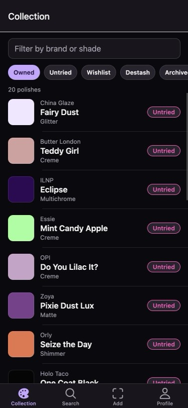 | 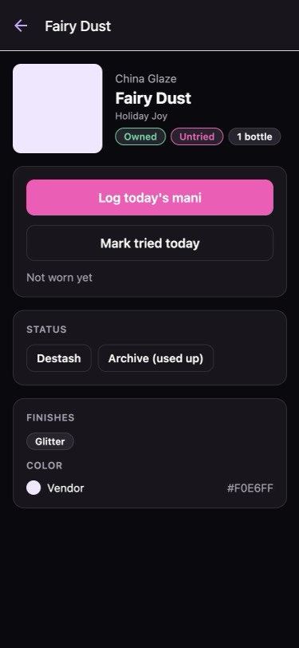 | 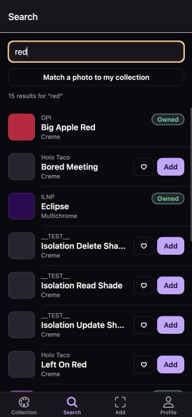 | 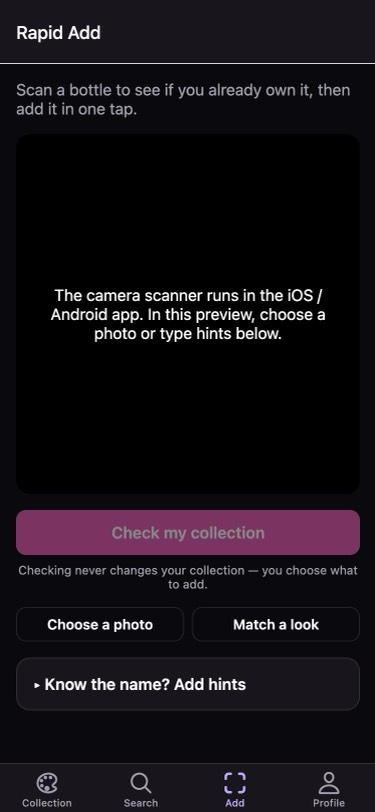 | 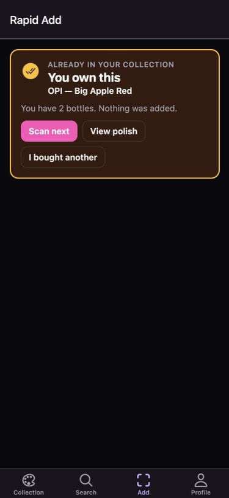 | 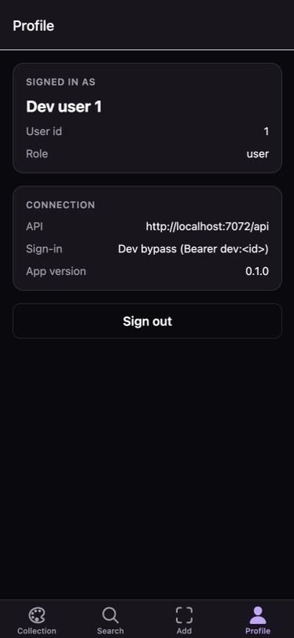 |

| Home + Pick for me | Mani log | Log a mani | Near-dupe verdict | Offline (saved copy) |
|---|---|---|---|---|
| 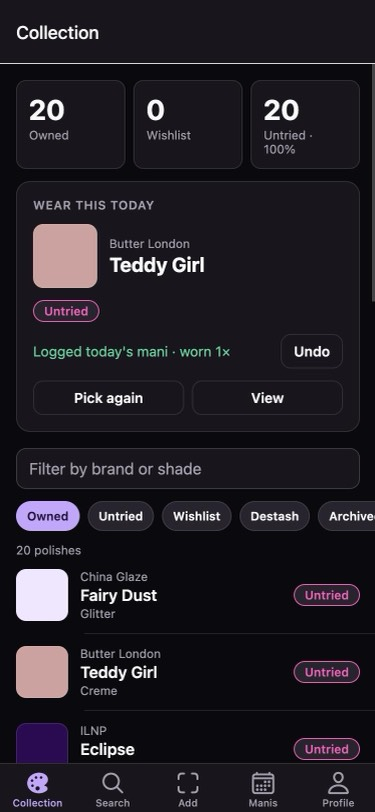 |  | 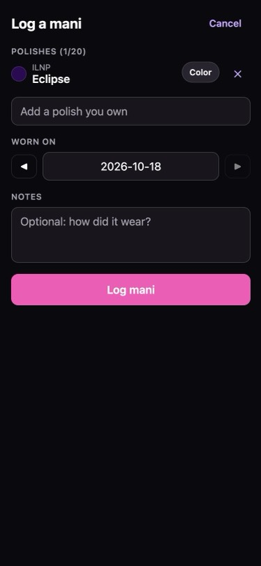 | 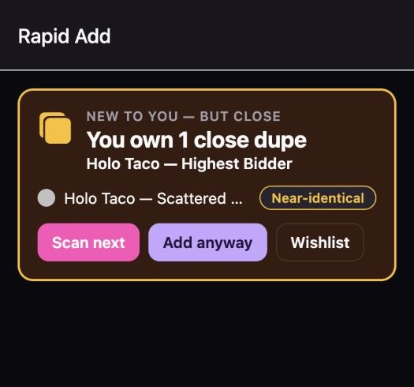 | 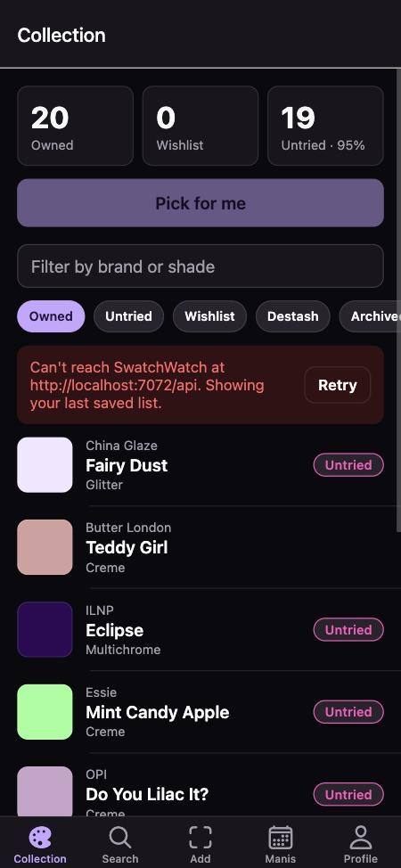 |

Native iOS 27 simulator (Xcode 27, iPhone 18 Pro, dev bypass against the local API): sign-in → Collection with Home panel; the camera permission prompt with the Info.plist text; a shutter photo uploaded as a `barcode` frame; and the check's "not in the catalog" verdict (the simulator's virtual camera sees a black frame, so a real scan needs a device).

| Collection | Camera permission | Frame sent | Check result |
|---|---|---|---|
| 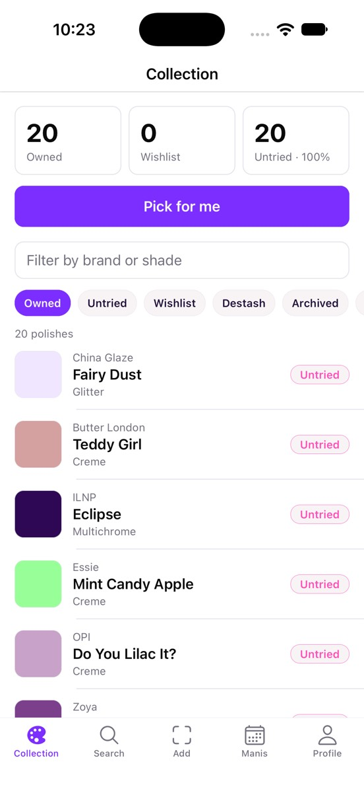 | 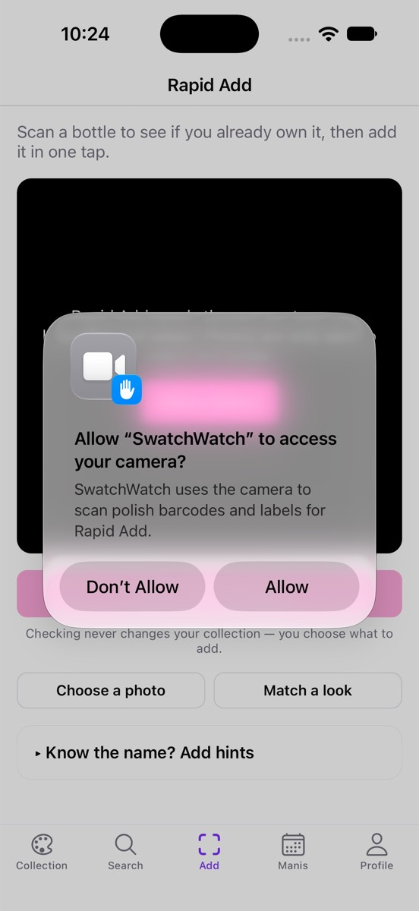 | 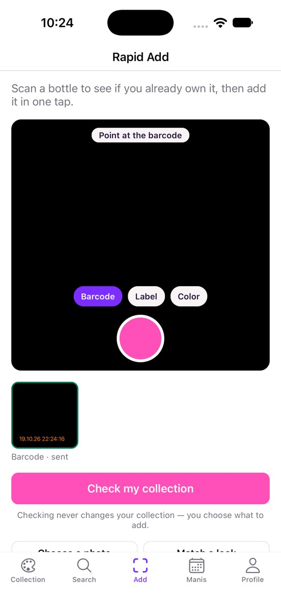 | 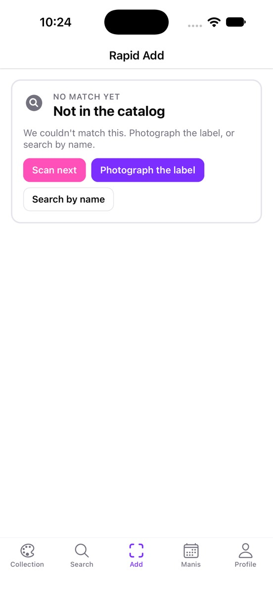 |

(The other screenshots are from the Expo web preview against a local Functions host in dev-bypass mode; the
camera itself only runs on a device.)

## Run it

```bash
npm run setup                 # once, from the repo root
cp apps/mobile/.env.example apps/mobile/.env.local
npm run dev:functions         # API on http://localhost:7071/api (AUTH_DEV_BYPASS=true locally)
npm run dev:mobile            # builds shared types, then `expo start`
```

Native iOS builds need full Xcode (`xcode-select -s /Applications/Xcode.app/Contents/Developer`) and CocoaPods (`brew install cocoapods`). The Xcode 27 SDK requires the UIKit scene lifecycle, which Expo SDK 57 adopts through the `expo-build-properties` plugin's `ios.enableSceneSupport` (set in `app.json`; SDK 58 includes it, then remove the plugin). Without it the app is killed at launch with "UIScene life cycle is required".

Then press `i` (iOS simulator), `a` (Android emulator) or `w` (web preview), or scan the QR
code with a development build. Useful variants, run from `apps/mobile`:

```bash
npx expo run:ios              # native dev build on the iOS simulator (needs Xcode)
npx expo run:android          # native dev build on an emulator (needs Android Studio)
npx expo start --web          # browser preview (no camera; API must allow the origin, see below)
```

`ios/` and `android/` are generated by `expo prebuild` (continuous native generation) and are
gitignored; change native settings in `app.json` instead.

Checks (also run in CI's **Mobile** job, which also bundles both platforms with `expo export`):

```bash
npm run lint --workspace=apps/mobile
npm run typecheck --workspace=apps/mobile
npm run test --workspace=apps/mobile      # node:test suites for the pure logic in src/lib
```

## Configuration (`.env.local`)

Only `EXPO_PUBLIC_*` variables reach the app; Expo inlines them at bundle time, so they are
public and must never hold secrets. Restart the bundler after changing them.

| Variable | Default | Meaning |
|---|---|---|
| `EXPO_PUBLIC_API_URL` | `http://localhost:7071/api` | Functions API base URL. On the Android emulator `localhost` is rewritten to `10.0.2.2`; on a phone use your computer's LAN address. |
| `EXPO_PUBLIC_AUTH_DEV_BYPASS` | unset | `true` = dev bypass (`Bearer dev:<id>`). Unset = dev bypass in development builds that have no Entra settings. `false` = off. |
| `EXPO_PUBLIC_AUTH_DEV_USER_ID` | `1` | User id for the dev-bypass token. |
| `EXPO_PUBLIC_B2C_TENANT` | — | Tenant subdomain (same value as the web's `NEXT_PUBLIC_B2C_TENANT`). |
| `EXPO_PUBLIC_B2C_TENANT_ID` | — | Tenant GUID (External ID authority). |
| `EXPO_PUBLIC_B2C_CLIENT_ID` | — | App registration client id (the web's). |
| `EXPO_PUBLIC_B2C_SIGNUP_SIGNIN_POLICY` | — | User flow; a `B2C_1_…` name selects legacy B2C, anything else is sent as `p=` to External ID. Unset with a tenant id = External ID without `p`. |
| `EXPO_PUBLIC_B2C_API_SCOPE` | `api://<client-id>/access_as_user` | API scope(s), space separated. |

The web preview (`expo start --web`, port 8081) calls the API from the browser, so the
Functions host must allow that origin (`CORS_ALLOWED_ORIGINS`, or `func start --cors
http://localhost:8081`). Native builds are not subject to CORS.

## Auth

`src/auth/auth-provider.tsx` has the same three modes as the web (`AUTH_MODE` in
`src/config/env.ts`):

- **Dev bypass** — the sign-in screen's "Continue as dev user" sends `Authorization: Bearer
  dev:<id>` to `POST /api/auth/validate`; the session is stored and re-validated on launch.
  Needs the local Functions host with `AUTH_DEV_BYPASS=true` (never works against Azure).
- **Entra External ID** — authorization code + PKCE with `expo-auth-session` against the same
  tenant and app registration as the web (`https://<tenant-id>.ciamlogin.com/<tenant-id>/v2.0`,
  scopes `openid profile offline_access api://<client-id>/access_as_user`), so the access token
  has the web's shape. Tokens live in the Keychain / Keystore (`expo-secure-store`), the access
  token is refreshed a minute before it expires, and every new session is checked with
  `/api/auth/validate` (a suspended account gets the API's message).
- **Not configured** — neither of the above; the sign-in screen says which variables to set.

### Redirect URI to register (owner action)

Sign-in needs one redirect URI added in the External ID tenant (Entra admin center → App
registrations → the web app's registration → Authentication → **Add a platform → Mobile and
desktop applications**):

```
swatchwatch://auth
```

That is `makeRedirectUri({ scheme: "swatchwatch", path: "auth" })` for development and store
builds (`scheme` in `app.json`). No new app registration or client secret is needed: the app is
a public client using PKCE. Expo Go uses a per-network `exp://<ip>:8081/--/auth` URI that can't
be registered reliably, so test sign-in with a development build (`npx expo run:ios`). The same
registration must keep exposing the `access_as_user` scope the web already uses.

## Structure

```
src/
  app/                    Expo Router routes (mirror the web's route groups)
    _layout.tsx           providers + Stack.Protected: (app) when signed in, sign-in otherwise
    sign-in.tsx
    (app)/_layout.tsx     stack over the tabs (detail, match)
    (app)/(tabs)/         Collection (index), Search, Add (Rapid Add), Profile
    (app)/polishes/[id].tsx   polish detail (web /polishes/detail?id=); owned polishes show `WearHistory` (newest 5 manis, "See all" → Manis tab with `?shade=<id>`; thumbnails via the in-memory private image loader only)
    (app)/match.tsx       Match to Collection (web /polishes/match)
    (app)/looks.tsx       Looks (web /polishes/looks)
    (app)/gaps.tsx        Collection gaps heatmap (web /polishes/gaps)
  api/client.ts           typed API client (mirrors apps/web/src/lib/api.ts)
  auth/                   auth provider, token holder, Entra config, secure storage
  components/             UI primitives, swatch, polish row, verdict card, frame strip,
                          private image, nail photo section, log-a-mani sheet
  config/env.ts           EXPO_PUBLIC_* config and auth-mode resolution
  lib/                    pure logic (+ *.test.ts): status rules, Rapid Add state, add guard,
                          photo match palette rules, private image URLs and memory cache,
                          photo picking (`pick-photo.ts`, camera/library → `prepareJpeg`),
                          color search (By color), Goes with, brand list price line
                          for the buy link (`buy-price.ts`)
  theme/theme.tsx         light/dark theme from the shared design tokens
```

| Route | Screen | API |
|---|---|---|
| `/sign-in` | Sign-in (per auth mode) | `POST /auth/validate` |
| `/` (tab) | Collection: Home panel (owned / wishlist / untried counts, Pick for me, one-tap Log today's mani), status presets (owned, untried, wishlist, destash, archived, all), filter, infinite scroll, pull to refresh | `GET /polishes?status=&untried=&search=`, `GET /polishes` (all owned, for the pick), `POST/DELETE /manicures` |
| `/manis` (tab) | Mani log newest first with private photo thumbnails, Log a mani sheet (owned polishes with roles, date, notes, optional photo), delete; `?log=<shadeId>` opens the sheet with that polish | `GET/POST/DELETE /manicures`, `PUT /manicures/{id}/photo` |
| `/polishes/[id]` | Detail: swatches, finishes, hexes, status actions, Mark tried, Log today's mani (undo), private nail photo (owned only), owned-dupe callout, **Goes with** (`components/goes-with.tsx`: complementary / analogous / triadic targets from the shared harmony rules, each with the closest owned color polish within `PAIR_MAX_DISTANCE`, else the target swatch + "Find in catalog" → `/search?hex=`), buy link with the brand list price under it ("Brand price $14.00 · as of …" from `buyPrice` / `buyCurrency` / `buyPriceSeenAt`, `src/lib/buy-price.ts`; hidden without both price and currency) | `GET/PUT/DELETE /polishes/{id}`, `GET /polishes/{id}/dupes`, `GET /polishes?status=owned&category=color`, `POST/DELETE /manicures`, `GET/PUT/DELETE /inventory/{id}/nail-photo` |
| `/search` (tab) | **Text \| By color** switch. Text: catalog search with Add / ♡ Wishlist behind the add guard (#266); fuzzy suggestions when nothing matches. By color (`components/color-search-panel.tsx`, `src/lib/color-search.ts`): 12-stop OKLCH hue strip + neutral and five lightness steps (no `react-native-svg`), color family chips, owned color polishes (D23) ranked by OKLAB `colorDistance` with HIGH / MEDIUM grade chips (dupe thresholds); "Catalog" asks the server for the nearest color polishes in the whole catalog (`?nearHex=`, narrowed only by selected family chips) with Add / ♡; with fewer than 10 owned matches the catalog is listed too, with a hint. `?hex=C0392B` (with or without `#`) or `?mode=color` opens By color | `GET /polishes?search=`, `GET /catalog/search`, `GET /polishes?category=color&family=&status=owned`, `GET /polishes?category=color&nearHex=&family=` |
| `/add` (tab) | Rapid Add (below) | `/capture/*` |
| `/looks` | Looks: vibe chips (occasion, mood, finish, Owned only, Include toppers), three looks from your owned polishes (`recommendLooks` from `swatchwatch-shared`, seeded; Shuffle changes the seed), steps marked Owned ✓ or Add with Add / ♡ behind the add guard, Save and a Saved tab, Wear this opens the mani sheet with the owned steps and roles | `GET /polishes?status=owned`, `GET /polishes?family=&nearHex=` (catalog gaps), `GET/POST/DELETE /looks`, `PUT /polishes/{id}`, `POST /manicures` |
| `/gaps` | Collection gaps (Home → "Collection gaps"): hue × lightness heatmap of the owned color polishes (touchable cells with count, swatch tint, missing = dashed, thin = amber), legend, and "What to add next" (missing cells, then the thinnest) with "Find in catalog"; a cell or next buy opens By color seeded with its representative hex (`/search?hex=`). Fewer than 5 owned colors: explanation + Rapid Add link. Owned hexes cached per user (stale-while-revalidate) | `GET /polishes?category=color&status=owned` |
| `/match` | Match a photo to your collection, wishlist or the catalog; Add / ♡ Wishlist on matches | `POST /polishes/match-image`, `PUT /polishes/{id}` |
| `/profile` (tab) | Signed-in user, API URL, sign-in mode, sign out | — |

## Rapid Add (Add tab)

- `expo-camera` scans EAN-13 / EAN-8 / UPC-A / UPC-E on device; codes are validated with the
  shared GS1 rules (`packages/shared/src/barcode/gtin.ts`). iOS reports UPC-A as a 0-prefixed
  EAN-13; the app sends the printed 12 digits because the capture API matches GTINs exactly.
- A scan starts a capture session with the GTIN (and any brand/shade hints), uploads a
  `barcode` frame as evidence and immediately asks `POST /api/capture/{id}/check`.
- The shutter adds `label` / `color` / `barcode` frames (≤ 6 per scan, JPEG ≤ 1600 px, EXIF
  dropped by re-encoding) to `POST /api/capture/{id}/frame`. Network errors, 408, 429 and 5xx
  retry automatically (1 s, 3 s); then the frame shows Retry / Remove.
- **Check, don't add:** unlike the web (which finalizes and offers an undo), mobile uses the
  read-only `check` endpoint, so the verdict never changes the collection:
  - *You own this* (bottle count; "I bought another" adds one),
  - *On your wishlist* ("I bought it" moves it to owned),
  - *New to you — but close* (owned near-dupes from `/polishes/{id}/dupes`; Add anyway / Wishlist),
  - *New to you* (Add / Wishlist),
  - *Which one is it?* (resolver candidates with ownership; pick one),
  - *Not in the catalog* (photograph the label / search by name).
  Adding uses `PUT /api/polishes/{shadeId}`; a barcode (SKU) match with no catalog shade is
  added through `POST /api/capture/{id}/finalize`.
- **Shelf mode** (`src/lib/shelf.ts`, `components/shelf-list.tsx`; web #426): every final verdict
  (own it / wishlist / near-dupe / new / not found; a pick waits for the choice) is appended to a
  shelf under the camera, newest first, with swatch, brand + shade, verdict chip and age. Entries
  keep the verdict they had when scanned and show what the shopper did afterwards (Added /
  Wishlisted / Bought another); the quick actions (Add, ♡ Wishlist, I bought another) use the
  same `PUT /api/polishes/{shadeId}` as the verdict card, never without a tap. "Scan next" keeps the
  list, a counts strip totals own / wishlist / new / not found, and a barcode scanned again is
  flagged in place ("Scanned already · 2 min ago") instead of appended. Up to 100 entries are
  saved per user through `api-cache` (ids, names, hexes, verdicts, GTINs and times only, never
  frames or private image URLs), restored on launch, and cleared by Clear shelf and on sign-out.
- No camera (simulator, denied permission, web preview): "Choose a photo" sends a library
  photo as a frame, and hints alone can be checked.

## Home, mani log and offline

- **Looks** (`/looks`, button on the Home panel) uses the web's recommender, which lives in `swatchwatch-shared` (`looks/recommend.ts`, so both apps recommend the same looks from the same seed). The screen fetches the owned list, runs `recommendLooks`, then asks `GET /polishes?family=&nearHex=` (and the topper finishes) for the catalog shades nearest the gaps and runs it again (`src/lib/looks.ts`, mirroring the web page). Save posts the same `SavedLookInput` snapshot the web saves, so saved looks appear on both. Not on mobile yet: per-step Swap, the details drawer, shopping list, share links, skin-tone preview, Color Lab.

- **Collection gaps** (`/gaps`, `src/lib/gaps.ts`) uses the shared gap rules (`color/gaps.ts` in `swatchwatch-shared`, the same cells as the web page); Pick for me's thin-cell weighting reads the same binning.
- **Pick for me** mirrors the web's weighting (`src/lib/pick-for-me.ts`: untried ×3, wear recency with a 2-day cooldown, thin hue × lightness cells ×2, never repeating the last three picks); the pick card logs today's mani in one tap with undo. **Pair it** uses the web's rule from `swatchwatch-shared` (`suggestPairings`, `color/pair-it.ts`): up to two owned pairings (complementary / analogous accent within `PAIR_MAX_DISTANCE`, or a topper) with swatches and a reason label; tap one to leave it out, and Log today's mani logs the pick (main) plus the selected pairings (accent / topper) as one manicure.
- **Log a mani** (`src/lib/mani.ts`, `components/log-mani-sheet.tsx`) builds the same `POST /api/manicures` body as the web form; roles cycle on tap. An optional photo (camera or library, re-encoded to JPEG ≤ 2048 px) is uploaded with `PUT /api/manicures/{id}/photo` right after the mani is created, the same order as the web form; if only the upload fails, the mani stays logged and the Manis tab says the photo wasn't saved. The Manis list shows each mani's photo as a private thumbnail. The polish detail shows worn count, last worn and tried/untried.
- **Stale-while-revalidate** (`src/lib/api-cache.ts`): the first page of each Collection filter set, the Home counts and the first page of the mani log (without photo URLs) are saved in AsyncStorage per user (7-day expiry, wiped on sign-out) and shown immediately while the fresh response loads. If the request fails the saved copy stays on screen with a banner. The signed-in user and token endpoint are stored with the session, so launching without a connection opens the saved data instead of the sign-in screen; the session is validated again as soon as a request reaches the API (a 401 or a rejected refresh token returns to sign-in).

## Match to Collection

`/match` (from Search or Rapid Add) takes a camera or library photo, downsizes it to a 512 px
JPEG and calls `POST /api/polishes/match-image` (server-side palette extraction; the API never
stores the image) with the same request as the web page (#373: up to 8 colors, 8 matches each).
It matches like the web (`src/lib/photo-match.ts`):

- **Scope** chips: My collection (default), Wishlist or Whole catalog; changing it re-runs the
  match on the photo already in memory.
- **Palette chips** choose which colors take part, on the device (no re-upload): background
  (light / shadow) and skin-tone colors are hidden by default unless the photo has nothing
  else, "Show all colors" brings them back, and tapping a chip drops or restores it.
- Matches are **grouped by photo color** (share of the photo, percent match and a Close match /
  Similar / Loose chip). Not-owned matches get **Add** (or "I bought it" on the wishlist) and
  **♡ Wishlist**, through the add guard (`src/lib/add-guard.ts`).
- **Match another photo** clears the photo and results.

On-device extraction (native Accelerate / Palette modules, #105) is still open in #109.

## Nail photo

The polish detail shows "On my nails" (`components/nail-photo-section.tsx`, web:
`NailPhotoPanel`) only for a polish the caller owns that has an `inventoryItemId`, and never
in Collection rows. It loads with `GET /api/inventory/{inventoryItemId}/nail-photo`
(`{ photo: null }` = no photo yet; a 404 hides the card), takes a camera or library photo
through `prepareJpeg` (≤ 2048 px JPEG) and saves it with `PUT`, and deletes after a confirm
with `DELETE`. Loading, error and offline states use the shared `ErrorBanner` with Retry.

Private media rules (shared with mani photos, `src/lib/private-image*.ts`,
`components/private-image.tsx`):

- Photos come back as owner-scoped `v3` image URLs. They are fetched only with the caller's
  bearer token and only from the API origin; with no token the request is not sent.
- The bytes become an in-memory data URI (small LRU) shown by `expo-image` with
  `cachePolicy="none"`, so nothing is written to a disk cache; sign-out clears the memory.
- Image bytes and capability URLs are never logged, and the offline mani-log copy in
  AsyncStorage drops photo URLs.

## Design tokens

`src/theme/theme.tsx` reads `LIGHT_THEME_COLORS` / `DARK_THEME_COLORS` / `BRAND_COLOR_TOKENS`
from `swatchwatch-shared`. That file is generated from the web theme
(`apps/web/src/app/globals.css`, `oklch()` → hex) by `npm run sync:design-tokens`; CI fails
when it drifts. Change colors in `globals.css`, then rerun the script.

## Monorepo notes

- The root `package.json` pins `react` / `react-dom` to `19.2.3` with `overrides` so the repo
  has one React: React Native's renderer must match React exactly, and the root `next`
  dependency would otherwise hoist a newer patch. Bump the override together with the web's and
  the Expo SDK's React versions.
- The shared package is consumed from `packages/shared/dist`; `npm run dev:mobile` builds it
  first, or run `npm run dev:shared` alongside to rebuild on change.
